  

<table>
  <tr>
    <td width="50%" valign="top">
      01 / METHOD  
      <strong>Reproducible by construction.</strong> 
      Declarative environments, explicit provenance, small interfaces, and
      changes that can be reviewed before they become infrastructure.
    </td>
    <td width="50%" valign="top">
      02 / SUBJECTS  
      <strong>Theses · papers · philanthropy.</strong> 
      An evolving body of technical and academic work, with its corresponding
      projects kept close enough to audit the argument.
    </td>
  </tr>
</table>
